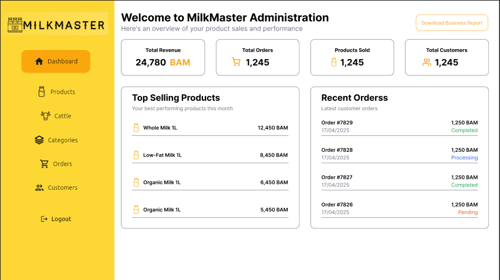
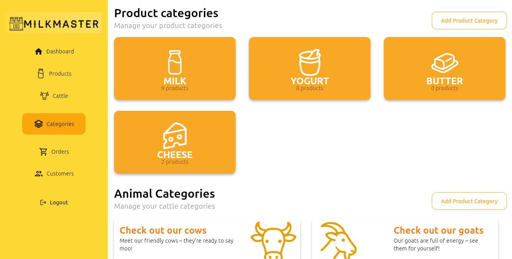
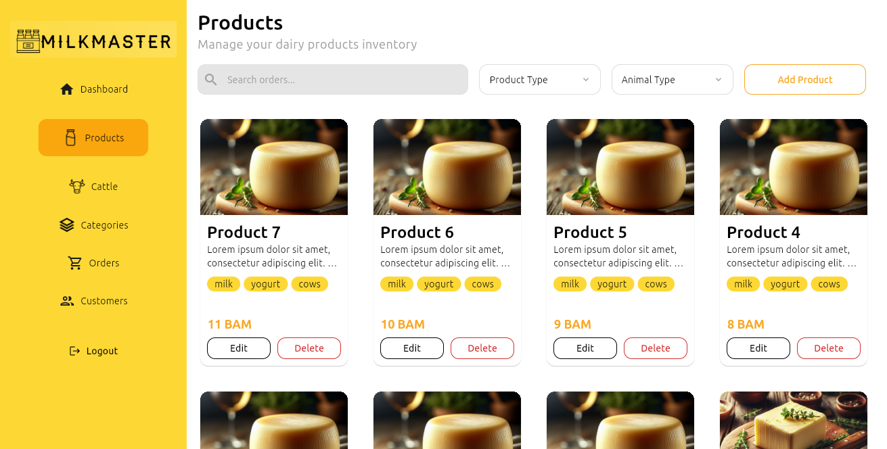
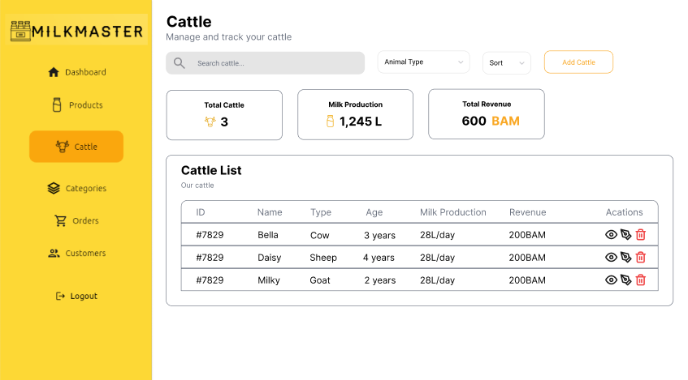
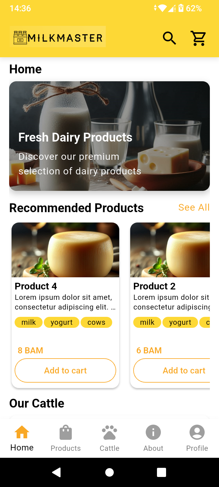
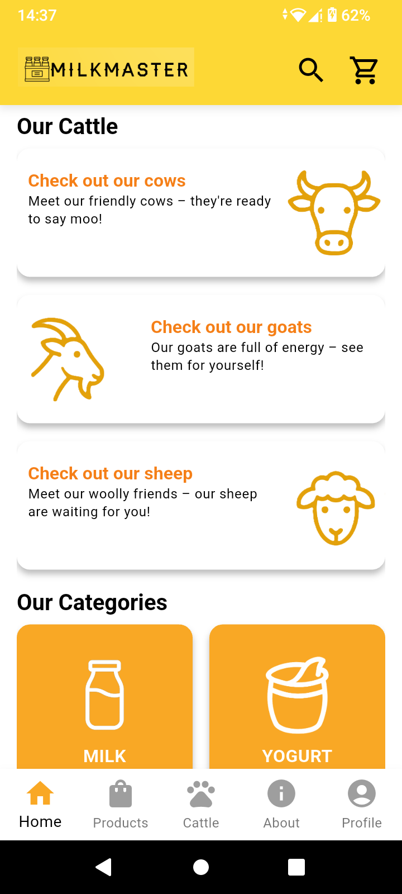
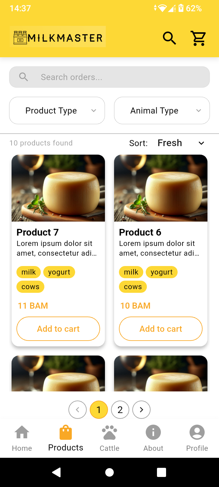
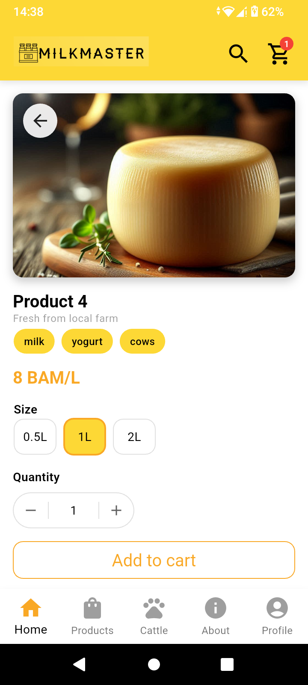
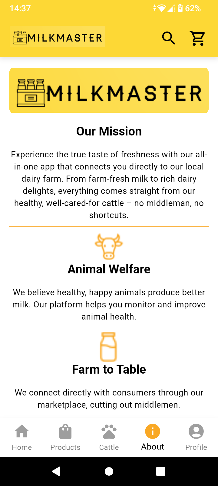
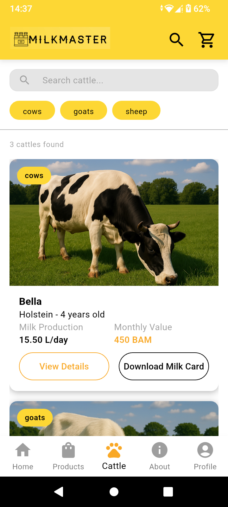

# MilkMaster

## Kredencijali za testiranje

### Administrator
- **Username:** desktop
- **Password:** Test1234!

### Korisnik
- **Username:** mobile
- **Password:** Test1234!

> **Napomena:** U bazi postoji više predefinisanih mobilnih korisnika (mobile1-mobile9). Za potpuno testiranje funkcionalnosti aplikacije, preporučuje se kreiranje novog korisničkog računa sa email adresom na koju imate pristup, kako biste mogli primati email notifikacije koje aplikacija šalje.

## Pokretanje aplikacije

### Automatsko pokretanje (preporučeno)

**Windows (Command Prompt):**
```cmd
cd MilkMaster
setup.cmd
```

**Linux/macOS:**
```bash
cd MilkMaster
chmod +x setup.sh
./setup.sh
```

### Ručno pokretanje

#### 1. Priprema okruženja
Raspakujte `.env` fajl u root direktorijum `MilkMaster/` projekta.

#### 2. Kreiranje baze podataka
Navigirajte u `MilkMaster.Domain` direktorijum i dodajte migraciju:
```bash
cd MilkMaster/MilkMaster.Domain
dotnet ef migrations add InitialMigration 
```

#### 3. Pokretanje Docker kontejnera
Vratite se u glavni `MilkMaster/` direktorijum i pokrenite Docker kontejnere:
```bash
cd ..
docker-compose up --build -d
```

> **Napomena:** Umjesto ručnog pokretanja, možete koristiti automatske skripte `setup.ps1` (Windows) ili `setup.sh` (Linux/macOS) koje automatski izvršavaju sve navedene korake.

## Zaustavljanje i čišćenje

Za zaustavljanje Docker kontejnera i brisanje migracija:

**Windows (Command Prompt):**
```cmd
cd MilkMaster
cleanup.cmd
```

**Linux/macOS:**
```bash
cd MilkMaster
chmod +x cleanup.sh
./cleanup.sh
```

Ove skripte će:
- Zaustaviti i ukloniti Docker kontejnere (`docker-compose down`)
- Obrisati folder sa migracijama (`MilkMaster.Domain/Migrations`)

Nakon cleanup-a možete ponovo pokrenuti `setup.cmd` / `setup.sh` za fresh instalaciju.

## Screenshots

### Desktop

Dashboard view:



Categories view:



Products view:



Cattle view:



### Mobile

Home screens:





Products list:



Single product:



About / Info:



Cattle (mobile):

